 

## 👋 Hi, I'm Mehmet

I am a co-founder and the COO of [Zeo](https://zeo.org), where I lead sales, marketing, operations and client success. I work at the point where search, growth marketing and generative AI meet: helping brands get found, and get cited, in an AI-first search world.

## 🔭 What I do

- 🧭 **Run the business side of Zeo:** revenue, operations and client success.
- 🔍 **Generative Engine Optimization (GEO):** how brands show up in ChatGPT, Perplexity, Gemini and Claude.
- 🤖 **AI-powered marketing:** turning agency know-how into repeatable products and automation.
- 🛠️ **Building small AI tools in the open**, like the one below.

## ⭐ Featured project

<table>
<tr>
<td>

### 💍 [oura-mcp](https://github.com/mehmetaktug/oura-mcp)

Talk to your **Oura Ring** from Claude, from anywhere. A free, read-only remote [MCP](https://modelcontextprotocol.io) server on **Cloudflare Workers**, with smart tools for sleep debt, weekly comparisons, HRV trends and readiness drivers.

`JavaScript` · `Cloudflare Workers` · `MCP` · `OAuth2`

</td>
</tr>
</table>

## 🏆 Recognition

- **Young Search Personality of the Year**, MENA Search Awards 2017

## 🧰 Tools I like

## 📫 Say hi

The best way to reach me is [LinkedIn](https://www.linkedin.com/in/mehmetaktug/) or [X](https://x.com/mehmetaktug).
